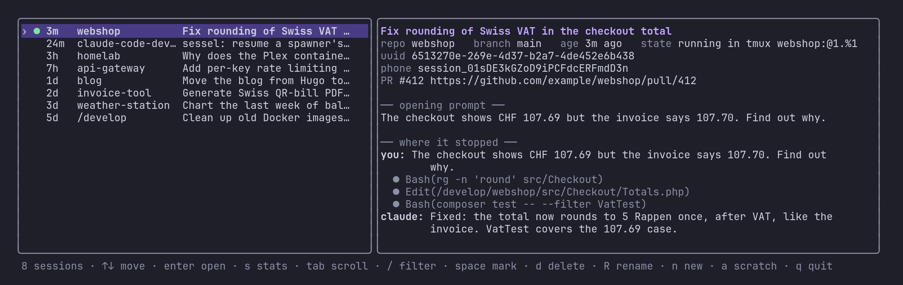

# claude-code-dev-container

A self-hosted development container that runs [Claude Code](https://claude.ai/code),
Codex and Antigravity (`agy`) alongside a full PHP / Go / Node / Python
toolchain, reachable over SSH from VS Code Remote-SSH and from the mobile app.

It runs on an Unraid box, but nothing here is Unraid-specific beyond the
`nobody:users` (99:100) uid convention and the share paths.

The point of it: one always-on box holds every repo and every Claude session.
You open a repo in VS Code from your laptop, and pick the same work up on your
phone without the laptop staying awake.

## Layout

```
conf.d/      client side: the dev* commands          (fisher installs these)
completions/ client side: tab completion for them    (fisher installs these)
container/   server side: image, entrypoint, helper scripts
docs/        images for this README
install.fish fisher-less installer, symlinks into ~/.config/fish
```

`conf.d/` and `completions/` sit at the repo root because that is the only
place [fisher](https://github.com/jorgebucaran/fisher) looks. Fisher copies
`functions/`, `completions/`, `conf.d/` and `themes/` from the root and ignores
everything else, so `container/`, `docs/` and this README are simply skipped.

## The container

`container/rebuild.sh` is the source of truth for how the container runs. It is
**not** defined by an Unraid template, so a change made through the Unraid UI or
an ad-hoc `docker run` is lost the moment the container is removed. Edit the
script instead.

```sh
./container/rebuild.sh
```

| Path | Purpose |
| --- | --- |
| `Dockerfile` | Debian sid base plus the toolchain |
| `entrypoint.sh` | sshd, Claude install, Remote Control host, session rebind |
| `trust-develop.sh` | Pre-accepts the workspace trust dialog for every repo |
| `rebind-sessions.sh` | Restores the previous run's Claude sessions on start |
| `wait-for-login.sh` | Holds Remote Control back until Claude can make an API call |
| `sessel/` | The session browser and spawner manager, see [sessel](#sessel) |
| `rebuild.sh` | Build and recreate the container |

### Persistence boundary

Only two volumes survive a rebuild:

| Volume | Holds |
| --- | --- |
| `/home/dev` | Claude's own install, credentials, session history, shell profile |
| `/develop` | Your repos |

Anything installed into the image filesystem at runtime is discarded. Put it in
the `Dockerfile`.

`/home/dev` is bind-mounted at runtime and never built into the image, which is
what `.dockerignore` is for: without it the ~5 GB home is sent to the daemon as
build context on every build.

### What is inside

Base is Debian sid, so most of this comes straight from apt at whatever version
sid currently carries. Versions below are what the running image has today, not
pins. Only the three `ARG` lines at the top of the `Dockerfile` are pinned.

**Runtimes**

| | Version | Why |
| --- | --- | --- |
| nodejs | 24.21 | Runs Claude Code and most tooling. From sid, so no NodeSource repo |
| npm | 12.0 | Ships with nodejs |
| python3 | 3.14 | From sid. `pipx` and `venv` included |
| php | 8.5.11 | From Sury's trixie suite: Debian sid has not done the 8.5 transition yet |
| go | 1.26.5 | Pinned via `ARG GO_VERSION`, installed from go.dev |

**PHP extensions worth calling out**

| | Version | Why |
| --- | --- | --- |
| openswoole | 26.2.0 | Built from PECL: Sury ships no 8.5 build, since openswoole lags new PHP releases |
| brotli | 0.21.0 | From PECL, bundled libbrotli |
| xdebug | installed | `phpdismod`-ed by default. `phpenmod -v 8.5 xdebug` to turn it on |
| redis, imagick, igbinary | apt | Common enough to be worth having preinstalled |

**Package and task managers**

| | Version | Why |
| --- | --- | --- |
| composer | 2.10.3 | PHP dependencies |
| pnpm | 12.6 | Preferred node package manager |
| yarn | 1.22 | For repos that still expect it |
| uv | 0.12.20 | Lets individual projects pin their own Python without rebuilding the image |
| task | 3.45.4 | Pinned via `ARG TASK_VERSION` |

**Browser and media**

| | Version | Why |
| --- | --- | --- |
| chromium | 154 | From apt, so puppeteer and lighthouse reuse it instead of each downloading a copy |
| lighthouse | 13.5.0 | Audits, against the apt chromium |
| ffmpeg | 9.0.2 | Media conversion |
| imagemagick | 7.1.2 | Image conversion |

**Shell and CLI**

| | Version | Why |
| --- | --- | --- |
| claude | updates itself | Installed by `entrypoint.sh` into the persisted home, not into the image |
| git | 2.55.0 | |
| gh | 2.46.0 | Used by `devclone` |
| tmux | 3.7c | Holds the Remote Control host and rebound sessions |
| ripgrep | 15.2.0 | Claude Code leans on it for search |
| fd | 10.5.0 | Symlinked from `fdfind` |
| bat | 0.26.1 | Symlinked from `batcat` |
| jq | 1.8.2 | |
| shellcheck | 0.11.0 | |
| sqlite3 | 3.53.4 | |
| mariadb-client | 11.8.9 | Matches the mariadb container it talks to |
| mdbook | 0.5.4 | |
| rsync | 3.5.1 | |

Both `fd` and `bat` are symlinked into `/usr/local/bin` because Debian ships
them as `fdfind` and `batcat` to avoid name clashes.

### Two container gotchas worth knowing

Both are already handled, and both cost real debugging time to find:

**`pam_loginuid` makes SSH silently do nothing.** sshd in a container cannot
write `/proc/self/loginuid`. PAM runs the rest of the stack, the MOTD even
prints, then the session is marked failed and sshd closes it *without* exec-ing
your command. SSH appears to connect, then exits 254. The `Dockerfile`
downgrades that module to `optional`, the standard container fix, which avoids
running privileged.

**Claude Code is deliberately not installed in the image.** An npm global
install lands in root-owned `/usr/local`, which the `dev` user cannot write, so
every auto-update dies with `no_permissions`. The entrypoint installs the native
build into the persisted home instead: `dev` owns it, it survives an image
rebuild, and it can update itself.

Host SSH keys are persisted in `/home/dev/.sshd` too, otherwise every rebuild
trips VS Code's "REMOTE HOST IDENTIFICATION HAS CHANGED" warning.

## Host setup

Add to `~/.ssh/config` on your workstation:

```ssh-config
Host tower
    HostName your-host.example
    User root
    IdentityFile ~/.ssh/id_tower
    IdentitiesOnly yes

Host tower-dev
    HostName your-host.example
    Port 2222
    User dev
    IdentityFile ~/.ssh/id_tower
    IdentitiesOnly yes
```

`tower` reaches the Docker host, `tower-dev` reaches the container. Put your
public key in `/home/dev/.ssh/authorized_keys` inside the volume. The fish
commands use both aliases, so keep the names or edit `conf.d/tower.fish`.

## The fish commands

With [fisher](https://github.com/jorgebucaran/fisher):

```sh
fisher install mbolli/claude-code-dev-container
fisher remove  mbolli/claude-code-dev-container
```

Without fisher:

```sh
./install.fish            # symlink into ~/.config/fish
./install.fish --uninstall
```

`install.fish` symlinks, so the file you edit is the file you commit. Existing
regular files are moved to `<name>.pre-install` rather than overwritten.

> Fisher refuses to install over files it does not own, with
> `Cannot install: please remove or move conflicting files first`. If you
> already have `~/.config/fish/conf.d/tower.fish` or any `completions/dev*.fish`
> from a manual install, remove them first (or `./install.fish --uninstall` if
> they are symlinks from this repo).

Every command that takes a repo accepts `swisscyberguard`,
`/develop/swisscyberguard` or `develop/swisscyberguard`, and tab-completes
against the live repo list (cached 10 minutes, with live descent into
subdirectories).

| Command | Does |
| --- | --- |
| `dev` | SSH into the container |
| `devcode <repo>` | Open a repo in VS Code over Remote-SSH |
| `devclone <owner/repo>` | Clone from GitHub into `/develop` and trust it |
| `devlink` | Print the claude.ai/code environment URL, with QR and clipboard |
| `sessel [cmd]` | Browse, peek, resume and delete sessions (see below) |
| `devwork <repo>` | Start or reattach a session for a repo, under tmux |
| `devls [-a] [-agent ...]` | List sessions with titles; either id in it works for `devresume` |
| `devstatus` | Container status and Remote Control state |
| `devrc` | Attach to the Remote Control tmux session |
| `devresume [id]` | Resume by uuid, `session_` id or claude.ai URL; the sessel TUI with none |
| `devcontinue [dir]` | Continue the last session in a directory |
| `devattach <id\|url> [dir]` | Re-attach a Remote Control session by id or URL |
| `devhoststart` / `devhoststop` | Start or stop the Remote Control spawner |
| `devtrust` | Pre-accept the trust dialog for every repo |
| `devrestart` / `devrebuild` | Restart or rebuild the container |

## Remote Control and the mobile app

`entrypoint.sh` starts a Remote Control host in `/develop` under tmux, in
`same-dir` mode with capacity 8. `same-dir` rather than `worktree` because
`/develop` holds many repos and is not itself a git repository, which worktree
mode requires. Press `w` in the pane to toggle when the cwd is a single repo.
The host exits when its own session is deleted on claude.ai, so it runs in a
restart loop; `devhoststop` ends the loop too.

`devlink` gives you the URL and QR code to open on your phone.

Two things that are easy to get wrong:

**One Remote Control process serves one directory**, and the phone can only
start sessions where one runs. The `/develop` host covers `/develop` itself;
`sessel serve` runs one more per recently used repo, so those show up on the
phone too. The entrypoint starts it at boot and it re-checks hourly. Repos
listed in `~/.claude/serve-pins` (one name per line) are served even when
unused. A spawner whose repo has a bridge pointer from the last 48 hours takes
that session back on start. The pointer only ever holds the spawner's own
pre-created session; sessions started from the phone are resumed from their
transcripts instead, under a new Remote Control id.
A second `remote-control` in a served folder fails with "already served".

**Updates need a restart.** The updater only repoints `~/.local/bin/claude`;
running processes keep their binary, and a spawner starts its sessions with its
own. `sessel upgrade` runs `claude update`, then restarts every spawner and
interactive `--remote-control` session on an older version, but only once its
sessions have been idle for 10 minutes and nobody is attached to the tmux
session. A restarted spawner takes back only the session in its bridge
pointer, its own pre-created one; the sessions it ran for the phone are resumed
with `sessel open -d`, under a new Remote Control id. It runs hourly after
`sessel serve`.

**Every session is on the phone.** The container's settings turn on
`remoteControlAtStartup`, and `devwork` and sessel also pass `--remote-control`
explicitly, named after the repo or the session's title.

## sessel

`sessel` (in `container/sessel`, Go, built into the image) manages Claude,
Codex and Antigravity (`agy`) sessions in the container. For Claude it knows
every session by either of its two ids: the transcript uuid, which
`claude --resume` takes, and the Remote Control id (`session_01…`, also
`cse_01…` or the end of a claude.ai/code URL), which the phone shows. The
Remote Control id changes every time a session is re-bridged, so the id on the
phone is often an older one; sessel resolves all of them. `claude` and `agy`
sessions resumed or started in tmux run with `--remote-control` enabled.

Run it with no arguments for the browser, from the laptop as `sessel` or
`devresume`:



| Key | Does |
| --- | --- |
| `↑` `↓`, `k` `j`, `pgup` `pgdn`, `g` `G` | Move through the session list (`g`/`G` jump to newest/oldest). The right pane pins the session's title, agent, repo, branch, state, UUID, phone ID and PR links at the top, and shows the opening prompt and latest turns below |
| `enter` | Open the selected session: resumes a stopped session in its own `tmux` session (`<repo>-<uuid8>`, `<repo>@codex-<uuid8>` or `<repo>@agy-<uuid8>`), attaches directly if it already runs in `tmux` (`●`/`◉`), or asks `y/N` before stopping a headless spawner (`◦`) or outside-tmux (`◐`) process and continuing its transcript in `tmux` |
| `/` | Live filter by title, repo, branch, agent, UUID or phone `session_01…` / `cse_01…` ID. While typing: `↑`/`↓` moves selection, `enter` opens the selected session immediately, `tab` keeps the filter active for batch actions, and `esc` clears it |
| `f` | Cycle agent filter (`all` -> `claude` -> `codex` -> `agy` -> `all`) |
| `l` | Toggle live-only filter (show only running sessions) |
| `a` | Toggle `/tmp` scratchpad and subagent probe sessions (hidden by default) |
| `esc` | Close help, or clear any active `/`, `f`, or `l` filters (press `esc` again with no filters, or `q`, to quit) |
| `s` | Switch the right pane between the conversation peek and session stats (disk footprint across all folders, prompts, turns, tool calls, runtime span, token usage, cache hits, models, bridge IDs, PR links) |
| `J` `K`, `ctrl+d` `ctrl+u` | Scroll the right pane by 3 lines (`J`/`K`) or half a page (`ctrl+d`/`ctrl+u`) without leaving the session list |
| `tab`, `→` | Focus the right pane for full keyboard scrolling (`tab`, `←`, `h` or `esc` returns to the list). A live session's peek starts at the bottom and follows new turns automatically |
| `space`, `d` | Mark/unmark sessions (`✗`) and advance (`space`); delete all marked sessions or the current one after a `y/N` confirmation showing total file count and byte size (`d`) |
| `R` | Rename a stopped session (updates the Claude transcript, Codex SQLite/index, or `agy` summary DB). Running sessions must be renamed from inside the session so the running process does not write its old title back |
| `n` | New project: creates `/develop/<name>` (or `<agent>:<name>` such as `codex:my-tool` or `agy:my-repo`), runs `git init`, starts a phone spawner for Claude, and opens the first session in `tmux` |
| `r` | Reload transcripts and live state immediately (also refreshes every 2 seconds) |
| `?`, `F1` | Toggle the in-app keyboard shortcuts guide and status marker legend (`◉` busy mid-reply, `●` live in tmux, `◦` idle in background spawner, `◐` live outside tmux, `✗` marked) |
| `q`, `ctrl+c` | Quit |

The same things are subcommands: `sessel ls` (`-agent claude|codex|agy`),
`open`, `peek`, `rename`, `rm`, `new` (`-agent claude|codex|agy` or
`<agent>:<name>`), `serve`, `upgrade`, `resolve`, `json`. `sessel --help`
lists them.

**Delete is real.** For Claude it removes the transcript, the session's
subagent and tool result directory, its file history, uploads, session env,
scratchpad, registry records and the per-process key files while keeping your
prompt history (`~/.claude/history.jsonl`) and the project's memory. For Codex
it runs `codex delete --force` (or, if `codex` is not installed, removes the
rollout JSONL, shell snapshot, thread writer lock,
`tui-thread-reference-capabilities` entry and SQLite rows in `state_5.sqlite`
with foreign-key cascades, `thread_history_1.sqlite` and `logs_2.sqlite`). For
`agy` it removes the brain directory, conversation database, annotations,
presence lock and summary row in `conversation_summaries.db`. A running session
is stopped first. `sessel rm -n <id>` shows exactly what would go.

A session is live only if its pid still belongs to the same process: pids
start from 1 after every rebuild, so an existing pid is often someone else.

### Session rebind on restart

Claude sessions are server-side objects, separate from the local transcript
UUIDs under `~/.claude/projects`. The entrypoint snapshots the session registry
(`~/.claude/sessions/*.json`) and each directory's `bridge-pointer.json`
*before* the host starts, because new processes reuse the old pids and the host
rewrites its pointer within a second. `rebind-sessions.sh` then brings back
every bridged session active in the last `REBIND_MAX_AGE_H` hours: spawner
sessions in a folder without a spawner as windows in the `rc` tmux session,
reattached under their old id, and interactive `--remote-control` sessions
resumed from their transcript in a tmux session of their old name.
In a folder that has a spawner, the spawner reclaims its pointer's session and
the others are resumed from their transcripts with `sessel open -d`.

Tunables, as environment variables read by the entrypoint:

| Variable | Default | Meaning |
| --- | --- | --- |
| `REBIND_ENABLE` | `1` | Rebind at all |
| `REBIND_MAX` | `10` | Most sessions to restore |
| `REBIND_MAX_AGE_H` | `48` | Only sessions active within this many hours |
| `REBIND_POINTERS` | `1` | Use the pointer snapshot |

`cat /tmp/rebind.log` in the container shows the last run.
